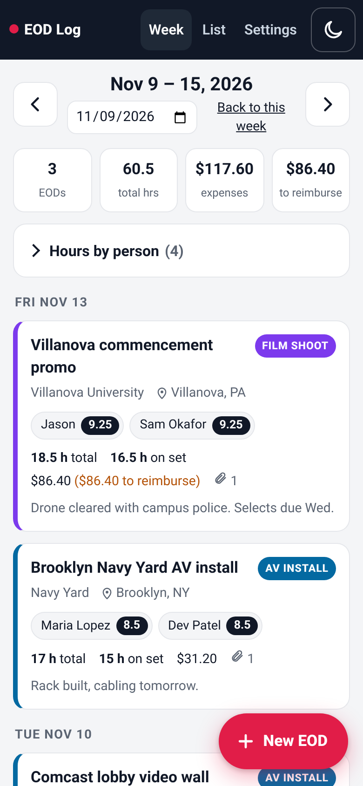
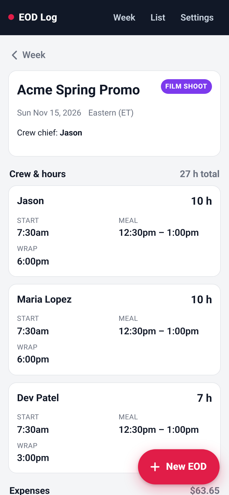
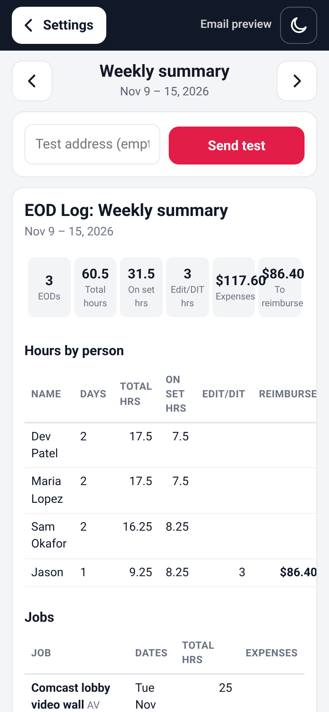
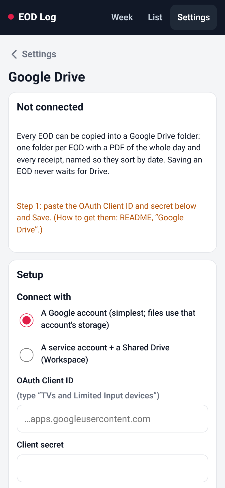
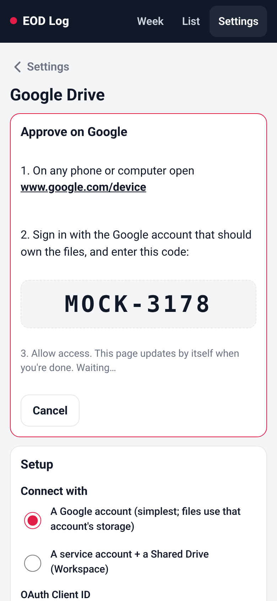
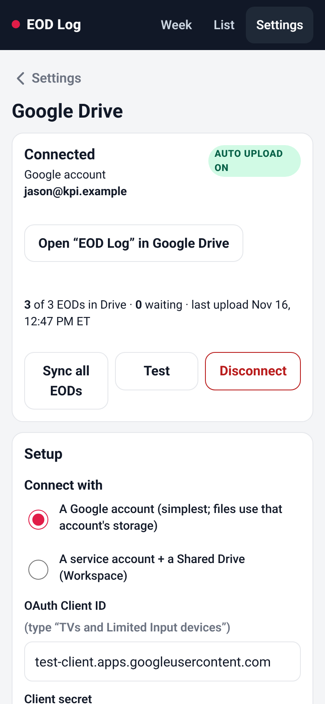
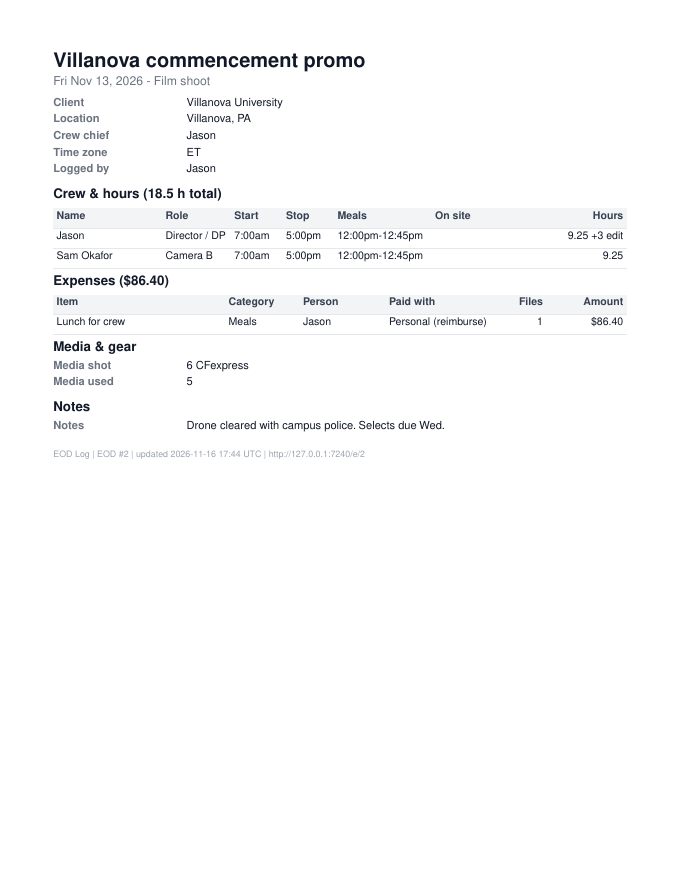

# EOD Log: end of day crew log

A small self-hosted web app that replaces the daily "Reply to this email with your hours" thread.
Crew log each job day from their phone (project, who worked, everyone's own start and stop times, expenses with receipt photos, vehicle, media, gear, notes),
everything is stored in a local SQLite database on the NAS, and managers get **summary emails on the schedule you choose** (daily, weekdays or weekly; as many as you like, each with its own recipients) with hours per person and per job, and what to reimburse. No EODs in the period = no email.

Built for film shoots, AV installs and live events. Mobile first: big tap targets, the phone's own date and time pickers, a floating **+ New EOD** button, add-to-home-screen (PWA).

**Status:** v2: start/stop hours, multiple notification schedules, and the time-saving fix. Tested in Docker with a fake mail server and in emulated iPhone/Android browsers (see "Testing"). No real email has been sent by the developer.

| Week view | New EOD | Entry with receipt | Notifications | Summary email |
|---|---|---|---|---|
|  |  |  |  |  |

## What it does

- **+ New EOD** (floating button on phones): job / project, date, job type (Film shoot, AV install, Live event, Edit / DIT, Other).
- **Crew & hours, per person.** Each person gets their own **Start** and **Stop**, and that's what makes the hours. Meal breaks are off by default: tap **+ Add meal break** for anyone who took one.
  Site time works the same way: **+ Add site time** reveals **On site** and **Off site** for that person (shown as a secondary on-site hours figure; it never changes the hours). A **More** fold-out holds role, Edit/DIT hours, a note, and "hours, if not using start/stop" for someone who just knows their total.
  On phones and tablets the time fields use the native time picker. On desktop they are plain text fields: type `7`, `730`, `7:30p` or `19:30` (or pick from the 15-minute list) and it tidies to e.g. `7:30 PM` when you leave the field. A half-typed or unreadable time is outlined in red and the EOD will not save until it is fixed, so nothing is silently dropped.
  Hours are worked out live as you type. **Add crew** starts the new person with the first person's times, and **Copy times to everyone** syncs them.
- **The rest of the old email** sits in fold-away sections so the quick path stays short: client, location, crew chief, time zone; expenses and receipts; vehicle, miles and tolls; # media taken and used; equipment requested by the client and equipment taken, provided and used; issues and damage; notes.
- **Expenses**: one line per receipt with amount, category, who paid, and **Company card** or **Personal (reimburse)**. Each line takes photos (camera or library) or PDFs. Big phone photos are shrunk in the browser to about 2000 px JPEG before upload, so uploads are fast and the NAS stays small.
- **Remembers**: crew names, projects, clients, locations, vehicles and roles autocomplete from past entries. **Duplicate for another day** copies a job and its crew for multi-day jobs. Unsaved new entries are kept as a draft on the phone (photos excepted).
- **Week view**: a week navigator with a date picker, totals (EODs, crew hours, expenses, to reimburse), hours by person, and entry cards grouped by day.
- **List view**: search (job, client, location, crew, notes) and filters (job type, person, date range), as cards.
- **Entry page**: every time per person, receipts as thumbnails, plus Edit, Duplicate and Delete (admin).
- **Email notifications** (Settings, admin): add as many as you want. Each has a name, its own recipients, **how often** (every day, weekdays, or weekly on a chosen day), the send time and time zone, an on/off switch, and an option to attach receipts.
  Each email has totals, hours by person (with Edit/DIT and the amount to reimburse), jobs, every EOD with a link, and an expense list that flags missing receipts.
  **If there are no EODs in the period, nothing is sent**; it's logged as *skipped*. Each notification has **Preview** and **Send test**, and Settings shows a notification log. The preview has a **Back** button pinned to the top (it returns to Settings or the notification you came from); it is never part of the email itself.
- **Google Drive copy** (Settings → Google Drive, admin): every EOD is uploaded to an organized, shareable Drive folder: a PDF of the day plus each receipt, named by date, job, expense and amount. Runs in the background with retries; saving an EOD never waits for Drive. See [Google Drive setup](#google-drive-setup).
- **CSV export** of hours (one row per person per day) and expenses, for payroll or spreadsheets.
- **Clear all data (admin only).** Settings → *Danger zone* → **Clear all data…** shows how many EODs, receipts and MB will go, links the CSV exports, and needs you to type `DELETE` plus the admin password. By default it deletes all EODs, expenses, receipts and uploaded files and keeps notifications; you can also choose to reset notifications, settings and the log. Before clearing it saves a database copy to `/data/backups/` (last 3 kept; receipt files are not included), then compacts the database.

### How hours are counted

- **Hours = Stop − Start − any meal breaks entered.** No meal entered = nothing deducted.
- Stop earlier than Start counts as past midnight (6pm to 2am = 8 h).
- On site / Off site are for the record only and **never change hours**. When On site and Off site are both filled in, the entry also shows **on-site hours**.
- If "hours, if not using times" is filled in, it wins.
- Edit/DIT hours are tracked separately and shown next to the hours, not added to them.

Want a different rule? It's one function: `public/hours.js` (shared by the browser and the server, with tests in `test/hours.test.js`).

## Sign-in and passwords

- **`APP_PASSWORD`** (required): one shared team password. Each person signs in once per phone (they can type their name so forms are pre-filled with it) and stays signed in for `SESSION_DAYS` (default 180).
- **`ADMIN_PASSWORD`** (optional, recommended): needed for **Settings**, **sending the summary**, and **deleting** entries. Anyone signs in with the team password; a manager can type the admin password at sign-in or when asked.
  If `ADMIN_PASSWORD` is empty, every signed-in person can do everything.
- Changing either password signs everyone out (sessions are signed with a key derived from them).
- Password tries are limited to 10 per 10 minutes per IP. The cookie is HttpOnly, SameSite=Lax, and Secure when the site is reached over https.
- Receipts are only served to signed-in users.
- Real passwords go in `.env` on the NAS or in Portainer's environment variables, **never in git** (`.env` is git-ignored).

## Run it with Docker Compose (on the NAS)

Needs Docker with the Compose plugin (Synology Container Manager, QNAP Container Station, TrueNAS, Unraid or plain Docker all work) and git on the NAS. Everything runs in **one container** (Node 22 + SQLite, non-root user `node`, uid 1000).

```bash
# first time only: clone (the repo is private, so git needs credentials; see "Git access on the NAS" below)
git clone https://github.com/moviemakr1620/eod-log.git eod-log
cd eod-log
cp .env.example .env        # then edit: APP_PASSWORD, ADMIN_PASSWORD, PUBLIC_URL, SMTP_*
docker compose build
docker compose up -d
docker compose logs -f      # should say: listening on :8080

# every later update: ALWAYS pull first, then rebuild
git pull
docker compose build
docker compose up -d
```

**Always run `git pull` before `docker compose build`**, otherwise you rebuild the old code. Your `.env` and the data volume are not in git, so a pull never touches them.

Then open **`http://<nas-ip>:7240`** on your phone and sign in. To put it on the home screen: Safari > Share > **Add to Home Screen**, or Chrome > ⋮ > **Add to Home screen** / **Install app**.

### Compose contract

- Service and container: **`eod-log`**, image `eod-log:latest`, `restart: unless-stopped`, healthcheck on `GET /healthz`.
- **Port:** `ports: "${EOD_PORT:-7240}:8080"`. The container listens on 8080; the NAS publishes it on **7240** (change `EOD_PORT` in `.env`).
- **Data:** named volume **`eod-data`** (real name `eod-log_eod-data`) mounted at `/data`. It holds:
  - `/data/eod.sqlite` (the database, WAL mode)
  - `/data/uploads/` (receipt files)
  - `/data/.session-secret` (made on first start)
- Hardening: `read_only: true` (with `tmpfs` on `/tmp`), `cap_drop: ALL`, and `no-new-privileges`.
- **Bind mount instead of a volume** (e.g. a NAS share you back up): replace `eod-data:/data` with `/volume1/docker/eod-log:/data`, then run `sudo chown -R 1000:1000 /volume1/docker/eod-log` once. The container runs as uid 1000 and must be able to write there.

### Backups

"Clear all data" automatically writes `/data/backups/eod-<UTC time>-before-clear.sqlite` first (the newest 3 are kept). For regular backups:

Back up the volume or bind-mount folder. That covers the database and receipts. For a consistent copy while it is running:
```bash
docker exec eod-log node -e "require('better-sqlite3')('/data/eod.sqlite').backup('/data/backup.sqlite').then(()=>console.log('ok'))"
```
then copy `backup.sqlite` and `uploads/` off the NAS (Hyper Backup, rsync, etc.).

### Portainer

**Easiest: use the prebuilt image.** Every push to `main` makes GitHub Actions build the app and publish it as `ghcr.io/moviemakr1620/eod-log:latest` (amd64 and arm64, so Intel and ARM NAS both work). Nothing needs to be built on the NAS.
1. **Stacks > Add stack > Web editor**, name it `eod-log`, and paste **`docker-compose.portainer.yml`**.
2. Under **Environment variables**, add at least `APP_PASSWORD`, and ideally `ADMIN_PASSWORD`, `PUBLIC_URL`, `SMTP_HOST`, `SMTP_PORT`, `SMTP_USER`, `SMTP_PASS`, `SMTP_FROM` and `MANAGER_EMAILS` (every variable is listed below).
3. **Deploy the stack.** The container should turn *healthy*.
4. To update later: open the stack, click **Update the stack**, and turn on **Re-pull image**.

The image package must be public for Portainer to pull it without a login (GitHub > your profile > Packages > `eod-log` > Package settings > Change visibility > Public). If you keep it private, add a registry in Portainer (**Registries > Add registry > Custom**, URL `ghcr.io`, your GitHub username, and a personal access token with only `read:packages`).

**Alternative: build from the repo.** **Stacks > Add stack > Repository**, URL `https://github.com/moviemakr1620/eod-log`, reference `refs/heads/main`, compose path `docker-compose.yml`. Portainer clones and builds it itself. Add the same environment variables.

Pick one way to run it: either `docker compose up -d` in the folder or the Portainer stack. They use the same container name.
*Easiest overall:* run `docker compose up -d` in the folder; Portainer still shows the container.

### Behind Nginx Proxy Manager + Cloudflare (optional)

Local access on port 7240 works without this. To reach it by name or from outside:
1. In **NPM > Proxy Hosts > Add Proxy Host**, set:
   - **Domain:** e.g. `eod.yourcompany.com`
   - **Scheme:** `http`
   - **Forward Hostname / IP:** `<nas-ip>`
   - **Port:** `7240`
   - **Websockets:** off
   - **Block Common Exploits:** on
   - **SSL tab:** Let's Encrypt or a Cloudflare Origin cert, with **Force SSL** on.
2. Raise NPM's upload limit for receipt photos. Under the **Advanced** tab, add `client_max_body_size 50m;`.
3. In Cloudflare, add DNS for `eod` as **Proxied** and set SSL/TLS to **Full (strict)**. Cloudflare's free plan allows 100 MB uploads, which is plenty.
4. Set `PUBLIC_URL=https://eod.yourcompany.com` so links in the email work, then run `docker compose up -d` (no rebuild needed; it's a runtime variable).

This puts a login page on the internet, protected only by the shared password. If the NAS is office-only, leave it on the LAN or VPN. Cloudflare Access (Zero Trust, free for small teams) is a good extra lock.

### Git access on the NAS

Because the repo is private, pick one:
- **Deploy key (read-only, best for a server).** Generate a key with `ssh-keygen -t ed25519 -f ~/.ssh/eod_log_deploy -N ""`.
  Add the `.pub` file on GitHub under the repo's **Settings > Deploy keys**, and leave "Allow write access" off. Then clone with:
  `GIT_SSH_COMMAND="ssh -i ~/.ssh/eod_log_deploy -o IdentitiesOnly=yes" git clone git@github.com:moviemakr1620/eod-log.git eod-log`.
  Inside the clone, run `git config core.sshCommand "ssh -i ~/.ssh/eod_log_deploy -o IdentitiesOnly=yes"` so later `git pull`s use the same key.
  (Each repo needs its own deploy key; GitHub won't reuse one key across repos.)
- **GitHub CLI:** `gh auth login`, then `gh repo clone moviemakr1620/eod-log eod-log`.
- **Personal access token:** a fine-grained token with read-only *Contents* access to this repo, used as the password when git asks. Never put it in a file in the repo.

## Email notifications setup

1. Set the SMTP variables (below) and restart the container (`docker compose up -d`, or *Update the stack* in Portainer).
   - **Gmail / Google Workspace:** `SMTP_HOST=smtp.gmail.com`, `SMTP_PORT=587`, `SMTP_USER=<the account>`, `SMTP_PASS=<an App Password>` (needs 2-step verification; a normal password won't work), `SMTP_FROM="EOD Log <that address>"`.
   - **Microsoft 365:** `smtp.office365.com`, port 587. SMTP AUTH has to be enabled for that mailbox.
   - **The NAS's own mail relay:** use its host and port. If it has a self-signed certificate, set `SMTP_TLS_REJECT_UNAUTHORIZED=false`.
2. Open **Settings** (admin password) > **Email notifications** > **Add**, or edit the one that's there. Notifications are saved in the database, not in env vars.
3. Use **Preview**, then **Send test** (on the edit page you can send the test to just yourself).

**What each frequency covers**

| How often | "Covers" option | Each email covers |
|---|---|---|
| Every day | That day (send in the evening, e.g. 19:00) | the send day |
| Every day | The day before (send in the morning) | the previous day |
| Weekdays (Mon–Fri) | That day | the send day; Monday's also includes Sat and Sun |
| Weekdays (Mon–Fri) | The day before | the previous day; Monday's covers Fri–Sun |
| Once a week (pick the day) | n/a | the previous Monday–Sunday |

**How sending works**
- The app checks every 30 seconds. On a send day at or after the send time, it decides once for that notification and period: **no EODs = skipped** (nothing sent, logged), otherwise it sends.
- Each notification and period is recorded in the database *before* sending, so a restart or a second check can never send it twice.
- The decision is made at send time: an EOD added later for an already-handled period is not emailed automatically. Use **Send test** if you need it.
- Adding or saving a notification after today's send time doesn't fire right away. It starts with the next send.
- A failed send (e.g. a wrong SMTP password) is logged as *failed* and not retried automatically, so it can't spam anyone. Fix it, then use **Send test**.
- It only sends while the container is running. If the NAS is off at the send time, it sends when it comes back up later that same day.

**Upgrading from the first version:** the old single weekly summary (its manager emails, day, time and receipts setting) becomes the first notification, "Weekly summary". If it already went out this week, it isn't sent again. The `MANAGER_EMAILS` and `SUMMARY_*` variables are now only used once, to create that first notification on a brand-new install.

## Google Drive setup

|  |  |  |  |
|---|---|---|---|

EOD Log can copy every EOD into Google Drive. Layout:

```
EOD Log/                                   <- the app creates this; share it from Drive or from the app
  2026/
    2026-11 November/
      2026-11-13 Villanova promo (Film shoot)/
        EOD 2026-11-13 Villanova promo.pdf                          <- every field, hours per person, expenses
        2026-11-13 Villanova promo - Lunch for crew - $86.40 (Personal).jpg
        2026-11-13 Villanova promo - Gas - $63.65 (Card) 1.jpg
        2026-11-13 Villanova promo - Gas - $63.65 (Card) 2.pdf
```

- New EODs upload automatically. Editing one replaces the PDF in place (Drive keeps the old versions), renames or moves the folder if the job or date changed, uploads new receipts and trashes removed ones.
- Deleting an EOD in the app renames its Drive folder to `(deleted) …` (or moves it to the trash, if you pick that).
- **Clear all data never deletes anything in Drive.**
- Uploads happen in the background. A failed upload is retried with backoff (30 s, 1 min, 2 min … up to 6 h), and Settings → Google Drive shows what's waiting or failing. **Sync all EODs** uploads everything already in the app. **Test** checks the folder.
- “Share the folder with” adds those people to the folder (view or edit) and Google emails them a link. You can also share it from Drive like any folder.

### Option A: a Google account (recommended, works with any Google or Workspace account)

The app signs in as one Google account and creates the folder in that account's My Drive, using that account's storage. It uses Google's sign-in for TVs and other devices: the app shows a code and you approve it on your phone. That means it works on a NAS reached over plain `http://` on the LAN, with no redirect URL or domain needed. It only asks for **`drive.file`** access: it can see and change only the files it created, nothing else in the Drive.

One-time setup in Google Cloud (about 5 minutes, free):

1. Go to <https://console.cloud.google.com/> signed in with the company Google account. Use the project picker at the top: **New project**, name it `EOD Log`, then **Create** and select it.
2. **APIs & Services → Library**: search for **Google Drive API**, open it, click **Enable**.
3. **APIs & Services → OAuth consent screen** (opens **Google Auth Platform**). Click **Get started**:
   - App name `EOD Log`, support email: yours.
   - **Audience: Internal** if this is a Google Workspace account (only your company can use it, no review needed, sign-in never expires).
   - For a personal @gmail.com account pick **External**. Then under **Audience** click **Publish app** (to "In production"), or the sign-in expires after 7 days. `drive.file` needs no Google review.
   - Contact email: yours. Agree and **Create**.
4. **Clients** (or **APIs & Services → Credentials → Create credentials → OAuth client ID**): Application type **TVs and Limited Input devices**, name `EOD Log NAS`, **Create**. Copy the **Client ID** and **Client secret**.
5. In EOD Log: **Settings → Google Drive**. Paste the Client ID and secret, set the folder name if you like, then **Save**. (Or set `GDRIVE_CLIENT_ID` / `GDRIVE_CLIENT_SECRET` in the container environment.)
6. Click **Connect Google Drive**. Open **google.com/device** on your phone, enter the code shown, pick the company account and **Allow**. The page switches to *Connected* by itself.
7. Click **Sync all EODs** to upload the existing ones, then **Open "EOD Log" in Google Drive**. Share it with the team there, or list emails under "Share the folder with".

The sign-in (a refresh token) is stored in the app's database on the `/data` volume. It is never shown or logged. **Disconnect** revokes it. Note that the database backups made by "Clear all data" contain it too, and are readable only by the container user.

### Option B: a Shared Drive with a service account (Google Workspace)

Use this if you'd rather the files belong to a Shared Drive than to one person. A service account has **no storage of its own**, so it can't upload into anyone's My Drive, even a folder shared with it (Google answers `storageQuotaExceeded`). It works only inside a **Shared Drive**.

1. In the same Google Cloud project, with the Drive API enabled: **IAM & Admin → Service accounts → Create service account** (name `eod-log`), **Done**.
2. Open it → **Keys → Add key → Create new key → JSON**. A `.json` file downloads; keep it private.
3. In Google Drive, open (or create) a **Shared Drive**, then **Manage members**. Add the service account's email (`eod-log@<project>.iam.gserviceaccount.com`) as **Content manager**. Make a folder in it for EODs and copy its link.
4. In EOD Log, **Settings → Google Drive**: choose **A service account + a Shared Drive**, paste the whole JSON key and the folder link, then **Save** and **Test**. (Or put the key file in `/data` and set `GDRIVE_SA_FILE=/data/sa.json`.) Some organizations block service-account keys by policy (`iam.disableServiceAccountKeyCreation`); then use Option A.

## Environment variables (every one)

| Variable | Default | What it does |
|---|---|---|
| `APP_PASSWORD` | *(none: nobody can sign in)* | Shared team password. **Required.** |
| `ADMIN_PASSWORD` | empty | Password for settings, sending the summary, and delete. Empty = everyone can. |
| `EOD_PORT` | `7240` | Host port (compose only). |
| `PUBLIC_URL` | `http://localhost:8080` | Address people use, for links in emails and CSVs. No trailing slash. |
| `APP_NAME` | `EOD Log` | Name in the header, emails and on the home screen. |
| `COMPANY_NAME` | `KPI` | Shown on the sign-in page. |
| `APP_TIMEZONE` | `America/New_York` | Default time zone for "today", new entries and timestamps. |
| `MAX_UPLOAD_MB` | `20` | Largest single receipt file. |
| `SMTP_HOST`, `SMTP_PORT` | empty, `587` | Mail server. Email features stay off until `SMTP_HOST` and `SMTP_FROM` are set. |
| `SMTP_SECURE` | auto (`true` on 465) | Implicit TLS. Leave empty for 587 (STARTTLS). |
| `SMTP_USER`, `SMTP_PASS` | empty | SMTP login. |
| `SMTP_FROM` | `SMTP_USER` | From address, e.g. `"EOD Log <eod@company.com>"`. |
| `SMTP_TLS_REJECT_UNAUTHORIZED` | `true` | `false` only for a relay with a self-signed cert. |
| `MANAGER_EMAILS` | empty | Fresh installs only: recipients for the first "Weekly summary" notification. After that, manage notifications in Settings. |
| `SUMMARY_ENABLED` | `true` | Fresh installs only: first notification on/off. |
| `SUMMARY_DAY` | `1` | Fresh installs only: its day, 0 = Sunday … 6 = Saturday. |
| `SUMMARY_TIME` | `08:00` | Fresh installs only: its send time (24-hour). |
| `SUMMARY_TIMEZONE` | `APP_TIMEZONE` | Fresh installs only: its time zone. |
| `SUMMARY_ATTACH_RECEIPTS` | `false` | Fresh installs only: attach receipts (capped at 15 MB per email). |
| `SESSION_DAYS` | `180` | How long a phone stays signed in. |
| `SESSION_SECRET` | auto (stored in `/data`) | Cookie signing secret. |
| `COOKIE_SECURE` | `auto` | `auto` = Secure cookie when reached over https. |
| `TRUST_PROXY` | `loopback, linklocal, uniquelocal` | Which proxies' `X-Forwarded-*` headers to trust (NPM on the LAN is covered). |
| `ALLOW_NO_PASSWORD` | `false` | `true` turns off sign-in entirely. Not recommended. |
| `GDRIVE_CLIENT_ID`, `GDRIVE_CLIENT_SECRET` | empty | Google OAuth client (type TVs and Limited Input devices) for the Drive copy. Can be pasted in Settings instead. |
| `GDRIVE_SA_FILE` | empty | Path inside the container to a service account `.json` (Shared Drive mode). Can be pasted in Settings instead. |
| `PORT`, `DATA_DIR` | `8080`, `/data` | Inside the container; normally leave alone. |

## Develop without Docker

Node 22 or newer:
```bash
npm ci
npm run dev          # http://localhost:8080 with APP_PASSWORD=dev, data in ./data
npm test             # unit tests (hours maths, Google Drive sync against a local fake)
```

## Testing

- `npm test`: unit tests for `public/hours.js` and the Google Drive sync (`test/drive.test.js`, run against `scripts/mock-google.mjs`, a small fake of the Google sign-in and Drive endpoints: names, device sign-in, uploads including big resumable ones, edits, moves, retries, deletes, sharing, service-account mode). Hours tests cover start/stop, optional meals, overnight, travel times ignored, typed-in hours, and time formats such as `07:30:00` and `7:30 PM`.
- `scripts/e2e.mjs`: about 70 end-to-end checks against a running server. It signs in, creates entries with several crew on separate hours and with receipts, then checks the week and list views, search and filters, editing, deleting receipts, admin-only actions, settings, CSV, the preview Back button and Clear all data (wrong confirmation, non-admin and cross-site attempts blocked). Set `DOCKER_EXEC='docker exec eod-log'` to also check that upload files are deleted and backups are written. With `GMOCK=` pointing at `scripts/mock-google.mjs` (and the server started with the test-only `GDRIVE_API_BASE` / `GDRIVE_OAUTH_BASE` pointing at it), it also runs the Google Drive flow: connect, share, sync, retry, delete.
  With `MAILPIT=` set, it also sends the summary to a [Mailpit](https://github.com/axllent/mailpit) catcher and checks the email, including attached receipts.
  `BASE=http://127.0.0.1:7240 APP_PASSWORD=... ADMIN_PASSWORD=... MAILPIT=http://127.0.0.1:8025 node scripts/e2e.mjs`
- `scripts/screenshots.mjs`: phone-size (390×844) screenshots into `preview/`. It needs `puppeteer-core` installed outside the project and Chrome.
- `scripts/browser-test.mjs`: drives the real form in **WebKit (iPhone 13)** and **Chromium (Pixel 7)** with Playwright. It covers add, edit, several crew, overnight, meals, a crew row with no name, and times with seconds. The simplest way to run it:
  `docker run --rm --network host -v $PWD:/w -w /w mcr.microsoft.com/playwright:v1.65.1-noble bash -c "npm i --no-save playwright@1.65.1 && APP_PASSWORD=... node scripts/browser-test.mjs"`
- `scripts/notify-test.mjs`: scheduler check (about 3 minutes) with Mailpit. A daily notification with no EODs sends nothing and is logged as skipped; with an EOD, two notifications send to their own recipients. A container restart afterwards sends no duplicates (checked by hand).

## Project layout

| Path | What |
|---|---|
| `src/server.js` | Express routes: pages, uploads, auth, summary, CSV. |
| `src/store.js`, `src/db.js` | SQLite schema and queries (better-sqlite3). |
| `src/views.js` | Server-rendered HTML (escaped by default). |
| `src/summary.js`, `src/mailer.js` | Summary data, email HTML/text, SMTP, notification schedules and the scheduler. |
| `src/drive.js`, `src/drivepdf.js` | Google Drive sync (sign-in, upload queue, folder layout) and the per-EOD PDF. |
| `src/auth.js` | Shared-password sign-in, signed cookies, admin elevation. |
| `public/` | `app.css`, `form.js` (EOD form), `hours.js` (shared hours maths), icons and manifest. |
| `test/`, `scripts/` | Unit test, fixtures, end-to-end and screenshot scripts. |

## Known limits

- One shared team password, not individual accounts. Anyone with it can add or edit any EOD, and an entry's "Logged by" is just the name typed at sign-in.
- No offline mode. The phone needs a connection to save, but an unfinished new entry is kept as a draft on the phone.
- HEIC photos from some Android or desktop browsers are stored as-is and may not preview. iPhones normally convert to JPEG when uploading.
- Not tested on real iPhones or Android phones, only in desktop Chrome at phone size. Not tested against a real SMTP provider, only Mailpit.
